# 🍲 Unsere Küche (Our Kitchen)

*[🇩🇪 Deutsche Version hier](README.md)*

A [Firebase](https://firebase.google.com) web app for the household: collect
**recipes**, plan the **week** with a "for later" list, generate the
**shopping list** automatically and keep track of the **pantry**. Recipes can
be read from photos of cookbook pages with **Gemini**, pasted as text or
imported as a file. The app syncs in real time between all devices, works
offline and can be installed like an app on your phone. Data lives in
[Cloud Firestore](https://firebase.google.com/docs/firestore); sign-in uses
Google accounts. The user interface is in German.

<p align="center">
  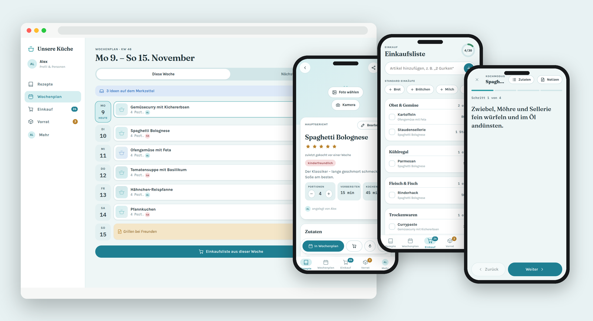
  <br><sub>With made-up sample data – more pictures under <a href="#screenshots">Screenshots</a></sub>
</p>

This documentation covers everything from zero to your own self-hosted
instance – access rules, local development and deployment.

> **Note:** Code and documentation contain no personal data (no real names,
> e-mail addresses, project IDs or credentials) and no recipes from
> cookbooks. All examples are made up.

---

## Contents

1. [Features](#features)
2. [Screenshots](#screenshots)
3. [Tech stack](#tech-stack)
4. [Project structure](#project-structure)
5. [Requirements](#requirements)
6. [Setup step 1: Firebase project](#setup-step-1-firebase-project)
7. [Setup step 2: Access rules](#setup-step-2-access-rules)
8. [Setup step 3: Local development](#setup-step-3-local-development)
9. [Setup step 4: Deploy to Firebase Hosting](#setup-step-4-deploy-to-firebase-hosting)
10. [Importing recipes](#importing-recipes)
11. [Configuration](#configuration)
12. [Tests](#tests)
13. [Database schema](#database-schema)
14. [Troubleshooting](#troubleshooting)
15. [Security notes](#security-notes)
16. [License](#license)

---

## Features

| Area | What it does |
|---|---|
| 📖 **Recipes** | Tiles with photo, time, rating and tags; search by title **and ingredient**; filter by category, tags and favourites; sort by name, last cooked, rating, duration or newest; "use soon" hint with matching recipes |
| 🍳 **Recipe page** | Scale servings (amounts adjust), ingredient sections ("for the dough"), numbered steps, "added by …", "last cooked … ago", tick off ingredients, "in the pantry" hint |
| 👩‍🍳 **Cooking mode** | One step per screen in large type, ingredients and notes on demand, **timers** from times mentioned in a step, screen stays on |
| 📝 **Notes** | A dated "our notes" list per recipe for changes and extra steps – with person and date, also visible while cooking |
| 🗓️ **Meal plan** | Any planning period (start day and 3–10 days, e.g. Friday to Friday); recipes or free entries per day and meal; a **"for later" list** for ideas and next week; mark meals as cooked |
| 🛒 **Shopping list** | **Generated from the meal plan**: identical ingredients are merged and converted, sorted by supermarket aisle (order adjustable); "probably at home" for pantry items; **staples** with one tap; "ticked off by …"; move bought items to the pantry |
| 🧺 **Pantry** | Food by fridge, freezer and cupboard; best-before with "tomorrow", "in 2 days"; mark **use soon** and find matching recipes |
| 📸 **Recipe import** | **Read a photo** – photograph a cookbook page, recipe card or handwriting and [Gemini](#importing-recipes) extracts the recipe (several pages or several recipes at once, foreign recipes are translated, unreadable parts are flagged instead of guessed); **paste text** (websites, Instagram, WhatsApp); **AI chat** for links and videos; **JSON file** for many recipes at once |
| 🔗 **Sharing & PDF** | Share a recipe as a link – recipients see only that recipe, can scale servings and save it as PDF; no sign-in, no server |
| 🖼️ **Photos** | From gallery or camera; compressed automatically after upload (about 100–190 KB instead of several MB) and shared with all devices |
| 👥 **People** | Own display names with colours; the app shows who added, planned, noted or ticked off something |
| 🎨 **Look** | Colour schemes Lagune, Fjord, Nest or **your own from 4 colours** (contrast is checked automatically); light, dark or automatic |
| 📴 **Offline & app** | Offline storage for data and app; installable (Android, iPhone/iPad with instructions, desktop); device check under "Mehr" |
| 💾 **Import & export** | Export/import recipes as JSON (with preview: new, already there, unusable), full backup including photos and restore |
| 🔒 **Access control** | Google sign-in only, and only for allowed, verified addresses – enforced server-side in the Firestore rules |

---

## Screenshots

> Everything shown is **made-up sample data**: two demo people "Alex" and
> "Sam" and ten simple sample recipes. The pictures come from the local test
> environment (Firebase Emulator), not from a real installation. The recipes
> intentionally have no photos – the app shows a placeholder instead.

### Recipes

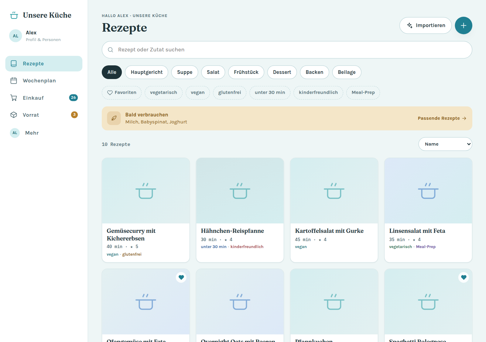

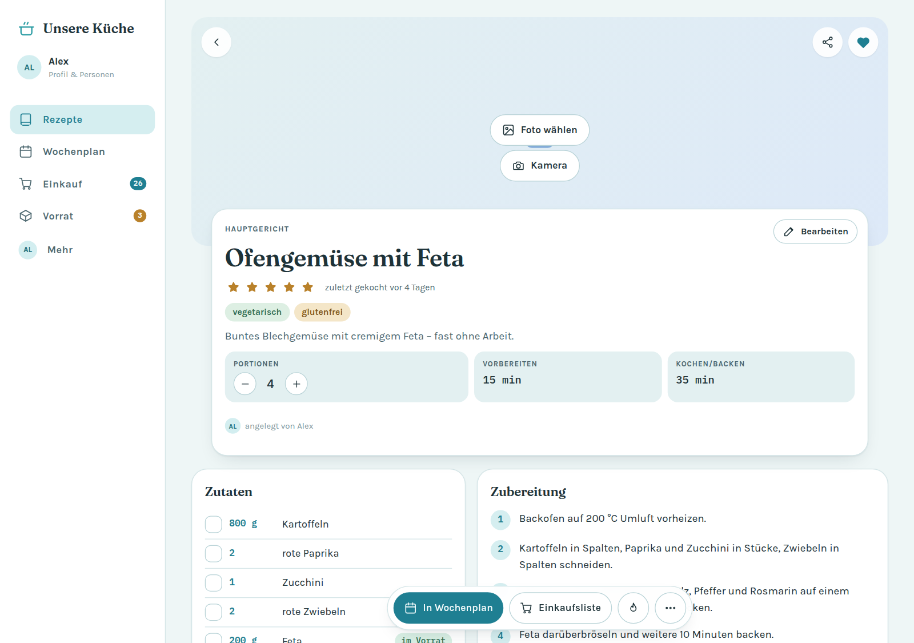

<table>
  <tr>
    <td align="center" width="25%">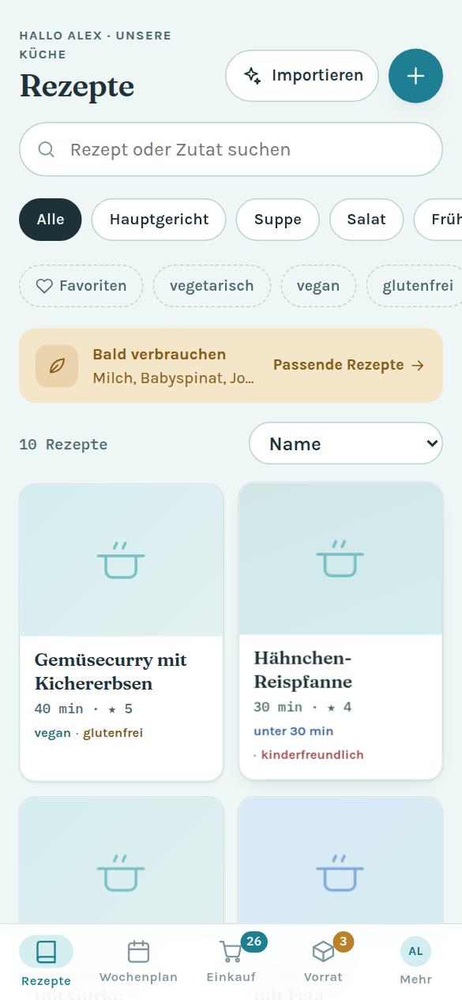<br><sub><b>Recipes</b> – search, filters and tiles</sub></td>
    <td align="center" width="25%">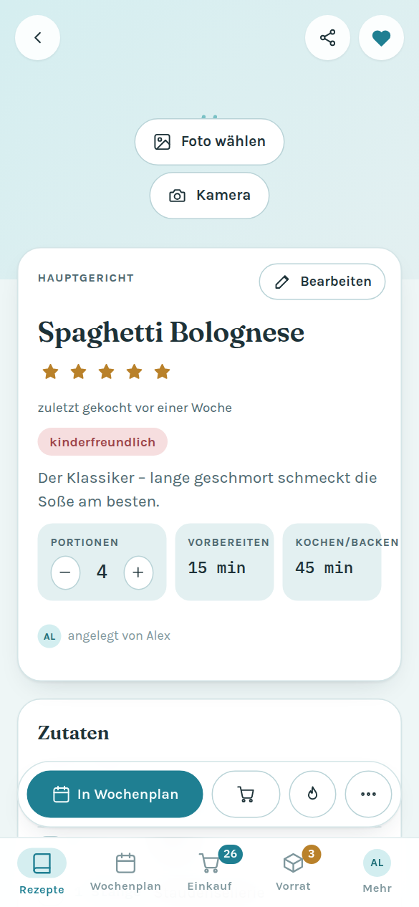<br><sub><b>Recipe</b> – scale servings, add a photo</sub></td>
    <td align="center" width="25%">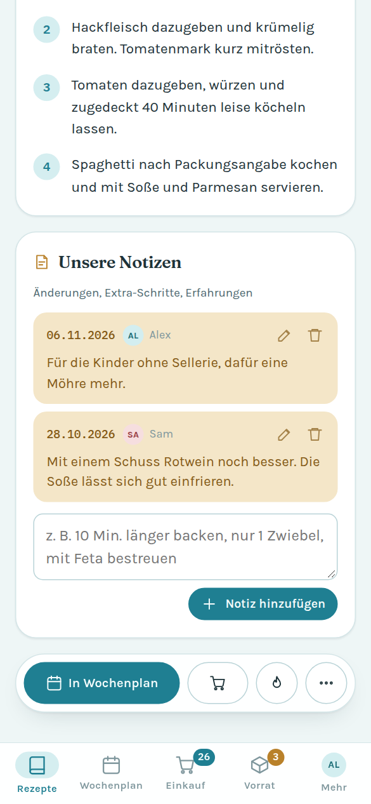<br><sub><b>Our notes</b> – dated, with person</sub></td>
    <td align="center" width="25%">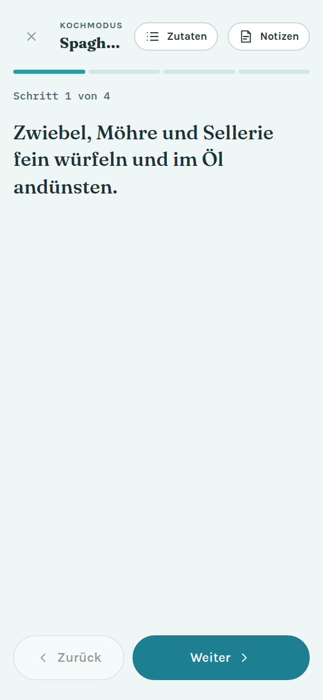<br><sub><b>Cooking mode</b> – one step per screen</sub></td>
  </tr>
</table>

### Meal plan, shopping and pantry

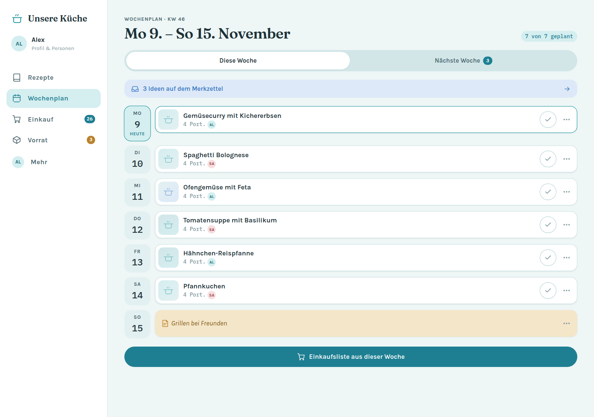

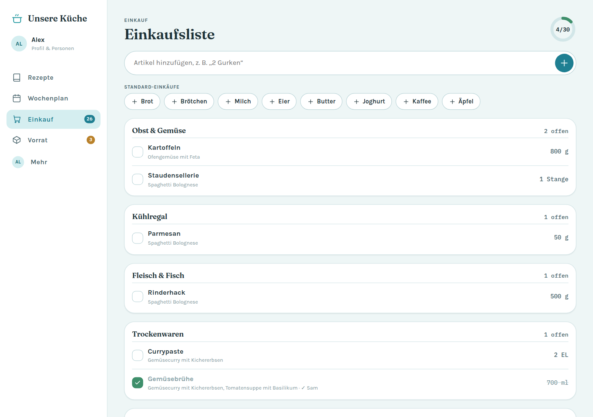

<table>
  <tr>
    <td align="center" width="33%">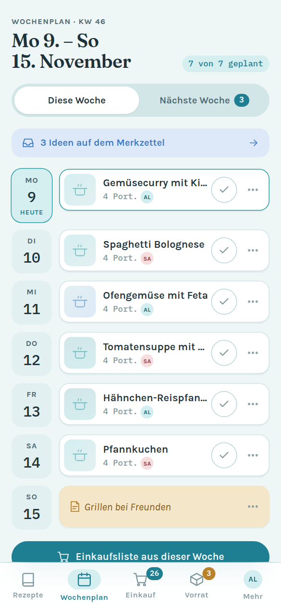<br><sub><b>Meal plan</b> – days, meals, "for later"</sub></td>
    <td align="center" width="33%">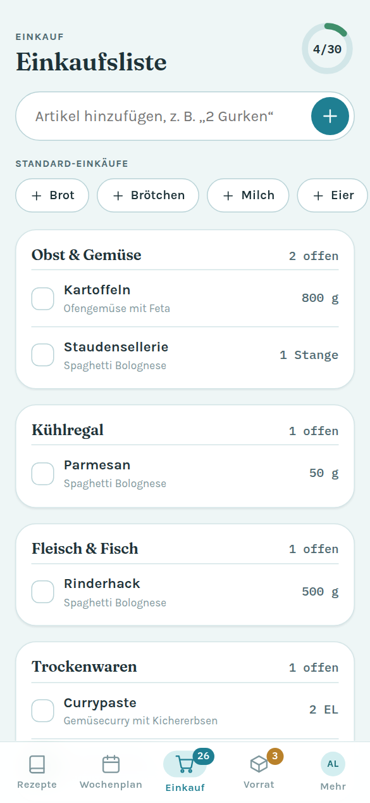<br><sub><b>Shopping list</b> – by aisle, with origin</sub></td>
    <td align="center" width="33%">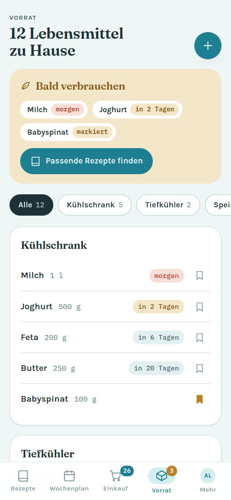<br><sub><b>Pantry</b> – best-before and "use soon"</sub></td>
  </tr>
</table>

### Import, sharing and settings

<table>
  <tr>
    <td align="center" width="33%">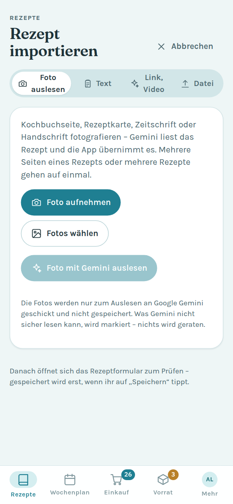<br><sub><b>Read a photo</b> – Gemini reads cookbook pages</sub></td>
    <td align="center" width="33%">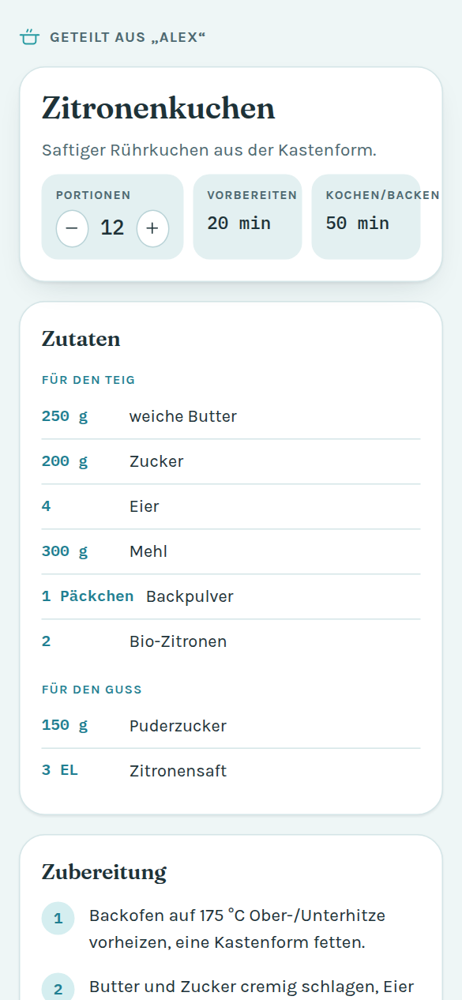<br><sub><b>Shared recipe</b> – no sign-in, save as PDF</sub></td>
    <td align="center" width="33%">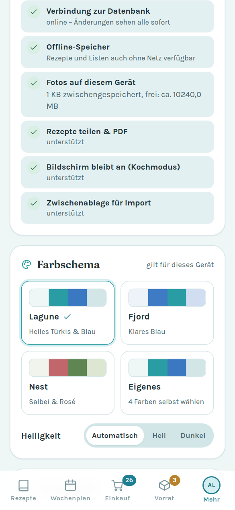<br><sub><b>Colour scheme</b> – including your own colours</sub></td>
  </tr>
</table>

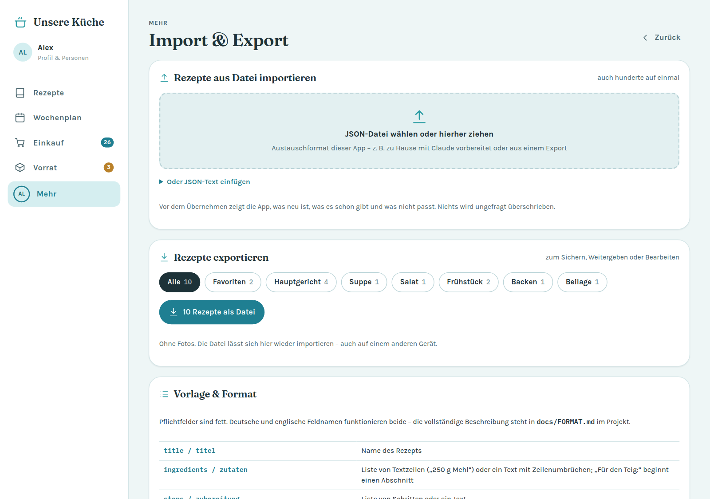

<table>
  <tr>
    <td align="center" width="50%">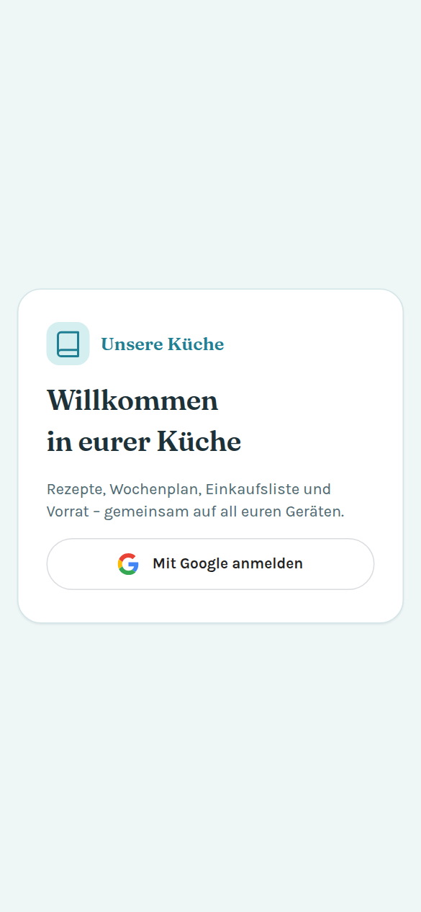<br><sub><b>Sign-in</b> – allowed Google accounts only</sub></td>
    <td align="center" width="50%">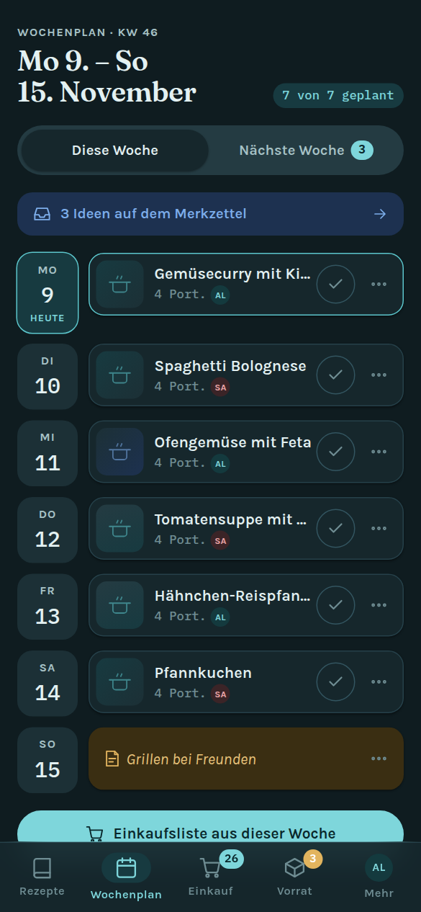<br><sub><b>Dark mode</b> – automatic or fixed</sub></td>
  </tr>
</table>

---

## Tech stack

- **Frontend:** HTML, CSS and JavaScript modules – no build step, no framework, no `npm install`
- **Database:** [Cloud Firestore](https://firebase.google.com/docs/firestore) with offline persistence; photos as compressed documents (no Cloud Storage needed)
- **Sign-in:** [Firebase Authentication](https://firebase.google.com/docs/auth) with Google
- **Recipes from photos:** [Firebase AI Logic](https://firebase.google.com/docs/ai-logic) with the Gemini Developer API (optional)
- **Hosting:** [Firebase Hosting](https://firebase.google.com/docs/hosting); service worker for offline start and installation
- **Firebase JS SDK** 12.19.0 loaded from `gstatic.com`
- **Tests:** Node.js test runner (`node --test`) and the Firestore emulator for the access rules
- **Cost:** runs on Firebase's free **Spark plan** – no credit card

---

## Project structure

```
├── firebase.json                  Hosting, Firestore, emulators
├── firestore.rules.example        template for the access rules (→ firestore.rules)
├── firestore.indexes.json
├── .firebaserc.example            template for the project alias (→ .firebaserc)
├── package.json                   scripts: start, emulators, test, test:rules, deploy
├── docs/
│   ├── FORMAT.md                  exchange format for recipe files (German)
│   ├── rezepte-vorlage.json       sample file to import
│   └── screenshots/               pictures for this README (sample data)
├── public/                        deployed to Hosting
│   ├── index.html, teilen.html    app shell, public page for shared recipes
│   ├── sw.js, manifest.webmanifest, icons/
│   ├── css/app.css
│   └── js/
│       ├── main.js                start, sign-in, navigation, router
│       ├── firebase.js            Firebase app, Google sign-in, Firestore
│       ├── firebase-config.js     loads the config (Hosting or local file)
│       ├── cloud.js               sync with Firestore, photos in Firestore
│       ├── store.js               in-memory data (all/get/add/update/remove)
│       ├── model.js               pure logic: ingredients, amounts, shopping list, periods
│       ├── ai-import.js           read recipe photos with Gemini
│       ├── recipe-text.js         recognise pasted recipe text
│       ├── exchange.js, importer.js   exchange format, import/export
│       ├── image.js, photos.js    compress and store photos
│       ├── theme.js               colour schemes
│       └── views/                 recipes, recipe, form, plan, shopping, pantry, settings …
└── tests/                         unit tests and rules tests
```

---

## Requirements

- A Google account for the [Firebase console](https://console.firebase.google.com)
- [Node.js](https://nodejs.org) 20+ (only for tests and the Firebase CLI)
- [Firebase CLI](https://firebase.google.com/docs/cli): `npm install -g firebase-tools`, then `firebase login`
- Java 11+ for the local Firebase emulators (optional)
- Python 3 for the local web server (`npm start`) – or any static server

---

## Setup step 1: Firebase project

1. Create a new project in the [Firebase console](https://console.firebase.google.com) (Google Analytics is not needed).
2. **Register a web app:** Project overview → "Add app" → Web (`</>`). You only need the shown config for local development (step 3).
3. **Create Firestore:** *Databases & storage → Firestore Database → Create database*, location e.g. `eur3` (Europe), start in **production mode**.
4. **Enable Google sign-in:** *Security → Authentication → Get started → Sign-in method → Google → Enable*, choose a support e-mail, save.
5. **Optional – recipes from photos:** *AI services → AI Logic → Get started →* choose the **Gemini Developer API** (not Vertex AI, which requires the paid plan). Everything except "read a photo" works without this step.

Or from the command line (steps 1–3):

```bash
firebase projects:create my-kitchen-project --display-name "Our Kitchen"
firebase apps:create web "Our Kitchen Web" --project my-kitchen-project
firebase firestore:databases:create "(default)" --location eur3 --project my-kitchen-project
```

Google sign-in (step 4) and AI Logic (step 5) can only be enabled in the console.

---

## Setup step 2: Access rules

Who may use the app is defined **only** in the Firestore rules – the app itself contains no addresses.

```bash
cp firestore.rules.example firestore.rules
```

Enter the Google addresses in `firestore.rules`:

```
request.auth.token.email in [
  "person1@example.com",
  "person2@example.com"
];
```

All data lives under `households/kueche/…`. Only signed-in accounts with a
**verified** address from this list can read and write; everything else is
denied. `firestore.rules` is listed in `.gitignore` so real addresses never
end up in the repository.

To add a person: add the address and run `firebase deploy --only firestore:rules`.

---

## Setup step 3: Local development

**With the Firebase emulators** (recommended, no real data):

```bash
npm run emulators          # Auth and Firestore emulators
npm start                  # second terminal: web server on port 5180
```

Open <http://localhost:5180/?emu=1>. Emulator mode offers a **test sign-in**
with any address from your `firestore.rules`; the app then talks only to the
emulator project `demo-…`. `?emu=0` switches back.

**Against the real project** (e.g. to try "read a photo"):

```bash
cp public/js/firebase-config.local.example.js public/js/firebase-config.local.js
```

and fill in the values from the Firebase console (*Project settings → Your apps → Web app*).
The file is git-ignored and never deployed – on Firebase Hosting the app
loads the values automatically from `/__/firebase/init.json`.

> On first start with an empty database the app creates a basic setup:
> categories, tags, supermarket aisles, an ingredient catalogue and staples.
> Recipes, plans and lists start empty.

---

## Setup step 4: Deploy to Firebase Hosting

```bash
cp .firebaserc.example .firebaserc     # enter your project ID
npm test                               # unit tests
npm run test:rules                     # access rules in the emulator
npm run deploy                         # Hosting + Firestore rules
```

The app then runs at `https://<project-id>.web.app`.

**Updates:** bump `CACHE` in `public/sw.js` with every change and list new
files in `APP_SHELL` – a test checks that none is missing.

**Install on a phone:** Android and desktop via "Als App installieren" under
*Mehr → App & Gerät*; iPhone/iPad via *Share → Add to Home Screen* (the app
shows step-by-step instructions).

---

## Importing recipes

| Way | For | How |
|---|---|---|
| 📸 **Read a photo** | cookbook pages, recipe cards, magazines, handwriting | take or choose photos → "mit Gemini auslesen" → one recipe opens the form for review, several open the import preview |
| 📋 **Text** | recipes from websites, Instagram, WhatsApp | paste text – title, ingredients and steps are recognised |
| ✨ **Link, video** | Instagram reels, YouTube, websites | copy the prompt, open Gemini or ChatGPT, paste the answer back (free, no setup) |
| 📄 **File** | many recipes at once | JSON in the [exchange format](docs/FORMAT.md); template: [docs/rezepte-vorlage.json](docs/rezepte-vorlage.json) |

**How "read a photo" works:** photos are scaled to about 2000 px and sent to
Gemini via Firebase AI Logic with fixed rules: copy amounts and steps exactly,
merge continuation pages, skip recipes cut off at the edge, describe
unreadable parts in `uncertain` instead of guessing, translate foreign
recipes into German. Gemini answers as JSON with a fixed schema; the app
highlights uncertain parts in the form and stores them as a note. The photos
themselves are not stored. The free tier has a daily limit set by Google, and
content sent there may be used to improve Google's services.

---

## Configuration

| What | Where |
|---|---|
| Firebase config | automatic on Hosting; locally `public/js/firebase-config.local.js` |
| Who has access | `firestore.rules` (e-mail list) |
| Household document | `HOUSEHOLD_ID` in `public/js/firebase.js` (default `kueche`) |
| Gemini model | `MODELS` in `public/js/ai-import.js` (latest Flash model, then fallback) |
| Planning period, meals, categories, tags, aisles, staples | in the app under *Mehr* (shared) |
| Colour scheme and brightness | in the app under *Mehr* (per device) |
| Basic setup for new households | `public/js/seed.js` |
| Photo compression | `public/js/image.js` (longest side 1280 px, target about 50–190 KB) |

---

## Tests

```bash
npm test             # core logic: ingredient parsing, amounts, shopping list, periods,
                     # text and photo import, exchange format, photos, app shell
npm run test:rules   # access rules against the Firestore emulator
```

The rules tests read the allowed addresses from `firestore.rules` (or the
template if there is none) and check that allowed accounts can read and
write, while other accounts, unverified addresses and guests cannot, and that
everything outside the household is locked.

---

## Database schema

```
households/kueche                     { settings: {...}, version }
households/kueche/recipes/{id}        title, description, servings, prepMin, cookMin,
                                      ingredients[{amount, unit, name, note, section}],
                                      steps[], categoryIds[], tagIds[], noteLog[],
                                      rating, favorite, lastCookedAt, photoId, by, createdAt
households/kueche/mealPlan/{id}       date, slot, recipeId | note, servings, cooked, by
households/kueche/planInbox/{id}      recipeId | note, servings   ("for later")
households/kueche/shoppingItems/{id}  key, name, amountText, aisle, source, checked, checkedBy
households/kueche/pantry/{id}         name, amount, location, expiresAt, useSoon
households/kueche/categories|tags|staples|catalog/{id}
households/kueche/photos/{id}         full, thumb (bytes), type, size
```

`settings` holds the household name, people (display name, colour, linked
Google account), meals, planning period and aisle order. The app keeps the
state in memory and writes only the changed documents after each change.

---

## Troubleshooting

| Problem | Fix |
|---|---|
| "Kein Zugriff" after sign-in | address missing in `firestore.rules` or rules not deployed (`firebase deploy --only firestore:rules`) |
| Google says "access blocked" | add the addresses as *test users* in the [Google Cloud project](https://console.cloud.google.com/auth/audience) |
| "Firebase-Konfiguration fehlt" | `public/js/firebase-config.local.js` is missing locally – or the app is not served by Firebase Hosting |
| "Gemini ist noch nicht eingeschaltet" | enable AI Logic in the console (setup step 1.5) and wait a few minutes |
| "Kontingent aufgebraucht" | daily free-tier limit reached – try later or use "link, video" |
| Old version after an update | reload once; the service worker fetches the new version |
| Sign-in pop-up blocked | allow pop-ups for the site |

---

## Security notes

- The Firebase config (API key etc.) is **not secret** – it is part of every
  web app. Data is protected by sign-in and the server-side Firestore rules.
- Real e-mail addresses live only in `firestore.rules`, which does not belong
  in the repository (see `.gitignore`).
- For "read a photo", [App Check](https://firebase.google.com/docs/app-check)
  is recommended so that only your app can use the Gemini quota.
- Shared recipe links contain the recipe itself (compressed in the link) and
  cannot be revoked.
- Signing out clears the device's offline storage.

---

## License

Private project. Add a license (e.g. MIT) if you want others to reuse it.
