# 🍲 Unsere Küche

*[🇬🇧 English version available here](README.en.md)*

Eine [Firebase](https://firebase.google.com)-Webanwendung für den Haushalt:
**Rezepte** sammeln, einen **Wochenplan** mit Merkzettel erstellen, daraus
automatisch die **Einkaufsliste** erzeugen und den **Vorrat** im Blick behalten.
Rezepte lassen sich aus Fotos von Kochbuchseiten mit **Gemini** auslesen, als
Text einfügen oder als Datei importieren. Die App synchronisiert in Echtzeit
zwischen allen Geräten, funktioniert offline und lässt sich wie eine App auf
dem Handy installieren. Als Datenbank dient
[Cloud Firestore](https://firebase.google.com/docs/firestore), die Anmeldung
läuft über Google-Konten.

<p align="center">
  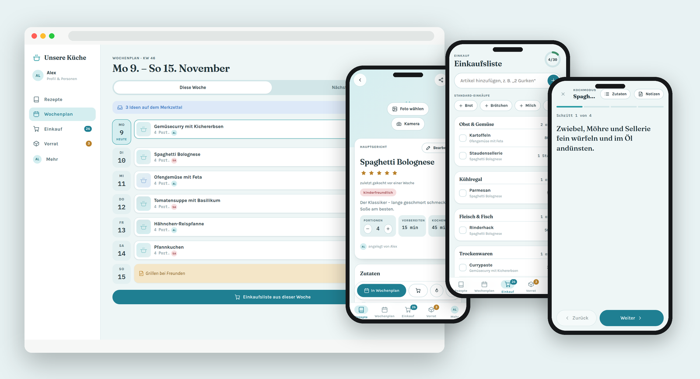
  <br><sub>Mit erfundenen Beispieldaten – mehr Bilder unter <a href="#so-sieht-die-app-aus">So sieht die App aus</a></sub>
</p>

Diese Dokumentation beschreibt den Weg von null bis zur eigenen, selbst
gehosteten Installation – mit Zugriffsregeln, lokaler Entwicklung und
Deployment.

> **Hinweis:** Code und Dokumentation enthalten keine personenbezogenen Daten
> (keine echten Namen, E-Mail-Adressen, Projekt-IDs oder Zugangsdaten) und
> keine Rezepte aus Kochbüchern. Alle Beispiele sind frei erfunden.

---

## Inhaltsverzeichnis

1. [Funktionsübersicht](#funktionsübersicht)
2. [So sieht die App aus](#so-sieht-die-app-aus)
3. [Technischer Stack](#technischer-stack)
4. [Projektstruktur](#projektstruktur)
5. [Voraussetzungen](#voraussetzungen)
6. [Setup Schritt 1: Firebase-Projekt einrichten](#setup-schritt-1-firebase-projekt-einrichten)
7. [Setup Schritt 2: Zugriffsregeln anlegen](#setup-schritt-2-zugriffsregeln-anlegen)
8. [Setup Schritt 3: Lokale Entwicklung](#setup-schritt-3-lokale-entwicklung)
9. [Setup Schritt 4: Deployment auf Firebase Hosting](#setup-schritt-4-deployment-auf-firebase-hosting)
10. [Rezepte importieren](#rezepte-importieren)
11. [Konfiguration](#konfiguration)
12. [Tests](#tests)
13. [Datenbank-Schema](#datenbank-schema)
14. [Troubleshooting](#troubleshooting)
15. [Sicherheitshinweise](#sicherheitshinweise)
16. [Lizenz](#lizenz)

---

## Funktionsübersicht

| Bereich | Funktionen |
|---|---|
| 📖 **Rezepte** | Kacheln mit Foto, Zeit, Bewertung und Tags; Suche nach Titel **und Zutat**; Filter nach Kategorie, Tags und Favoriten; Sortierung nach Name, zuletzt gekocht, Bewertung, Dauer oder neueste; Hinweis „Bald verbrauchen“ mit passenden Rezepten |
| 🍳 **Rezeptseite** | Portionen umrechnen (Mengen passen sich an), Zutaten in Abschnitten („Für den Teig“), Zubereitung in Schritten, „angelegt von …“, „zuletzt gekocht vor …“, Zutaten abhaken, Hinweis „im Vorrat“ |
| 👩‍🍳 **Kochmodus** | Ein Schritt pro Bildschirm in großer Schrift, Zutaten und Notizen einblendbar, **Timer** aus Zeitangaben im Schritt, Bildschirm bleibt an |
| 📝 **Notizen** | Pro Rezept eine datierte Liste „Unsere Notizen“ für Änderungen und Extra-Schritte – mit Person und Datum, auch im Kochmodus sichtbar |
| 🗓️ **Wochenplan** | Planungszeitraum frei wählbar (Starttag und 3–10 Tage, z. B. Freitag bis Freitag); Rezepte oder freie Einträge („Grillen bei Freunden“) je Tag und Mahlzeit; **Merkzettel** für Ideen und für die nächste Woche; „gekocht“ abhaken |
| 🛒 **Einkaufsliste** | **Automatisch aus dem Wochenplan**: gleiche Zutaten werden zusammengefasst und umgerechnet, nach Supermarkt-Abteilungen sortiert (Reihenfolge einstellbar); „Wahrscheinlich schon da“ für Zutaten aus dem Vorrat; **Standard-Einkäufe** mit einem Tipp; „abgehakt von …“; Erledigtes in den Vorrat übernehmen |
| 🧺 **Vorrat** | Lebensmittel nach Kühlschrank, Tiefkühler und Speisekammer; Haltbarkeitsdatum mit „morgen“, „in 2 Tagen“; **Bald verbrauchen** markieren und passende Rezepte finden |
| 📸 **Rezepte importieren** | **Foto auslesen** – Kochbuchseite, Rezeptkarte oder Handschrift fotografieren, [Gemini](#rezepte-importieren) liest das Rezept (auch mehrere Seiten oder mehrere Rezepte auf einmal, fremdsprachige werden übersetzt, Unleserliches wird markiert statt geraten); **Text einfügen** (Webseite, Instagram, WhatsApp); **KI-Chat** für Links und Videos; **JSON-Datei** für viele Rezepte auf einmal |
| 🔗 **Teilen & PDF** | Rezept als Link teilen – Empfänger sehen nur dieses Rezept, können Portionen umrechnen und es als PDF speichern; ohne Anmeldung, ohne Server |
| 🖼️ **Fotos** | Foto aus Galerie oder Kamera; wird nach dem Hochladen automatisch verkleinert (ca. 100–190 KB statt mehrerer MB) und mit allen Geräten geteilt |
| 👥 **Personen** | Eigene Anzeigenamen mit Farbe; die App zeigt, wer etwas angelegt, eingeplant, notiert oder im Laden abgehakt hat |
| 🎨 **Aussehen** | Farbschemata Lagune, Fjord, Nest oder **eigenes aus 4 Wunschfarben** (Kontrast wird automatisch geprüft); hell, dunkel oder automatisch |
| 📴 **Offline & App** | Offline-Speicher für Daten und App; installierbar als App (Android, iPhone/iPad mit Anleitung, Desktop); Gerätecheck unter „Mehr“ |
| 💾 **Import & Export** | Rezepte als JSON exportieren/importieren (mit Vorschau: neu, schon vorhanden, unbrauchbar), komplette Sicherung inkl. Fotos und Wiederherstellen |
| 🔒 **Zugriffsschutz** | Anmeldung nur mit Google und nur für freigegebene, bestätigte Adressen – serverseitig in den Firestore-Regeln geprüft |

---

## So sieht die App aus

> Alle Inhalte auf den Bildern sind **erfundene Beispieldaten**: zwei
> Demo-Personen „Alex“ und „Sam“ und zehn einfache Beispielrezepte. Die Bilder
> stammen aus der lokalen Testumgebung (Firebase Emulator), nicht aus einer
> echten Installation. Die Rezepte haben bewusst keine Fotos – an ihrer Stelle
> zeigt die App einen Platzhalter.

### Rezepte

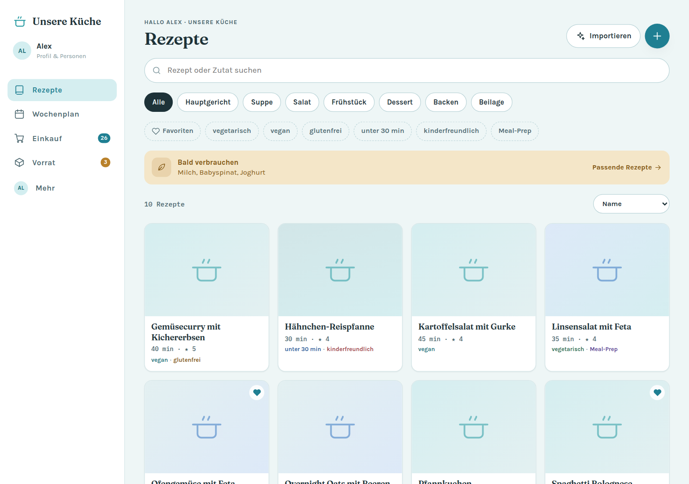

Suche über Titel und Zutaten, Filter nach Kategorie und Tags, darüber der
Hinweis auf Lebensmittel, die bald verbraucht werden sollten – mit passenden
Rezepten.

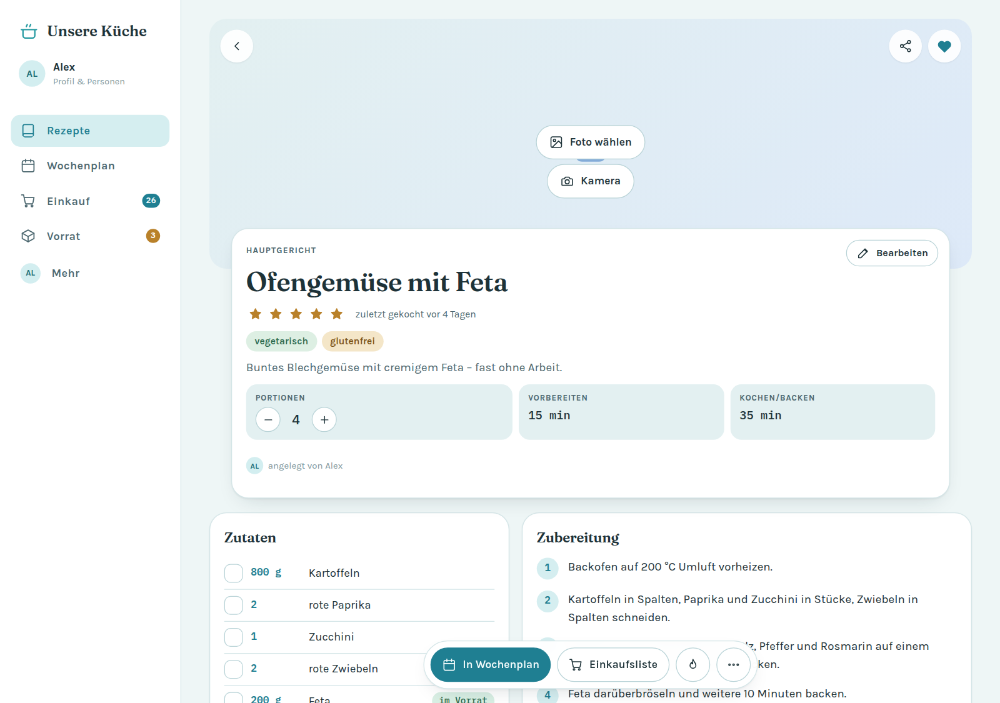

<table>
  <tr>
    <td align="center" width="25%">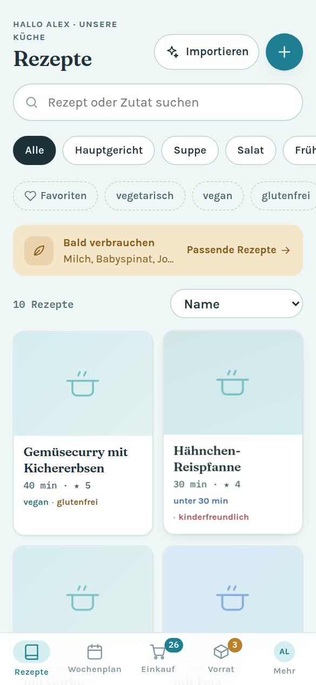<br><sub><b>Rezepte</b> – Suche, Filter und Kacheln</sub></td>
    <td align="center" width="25%">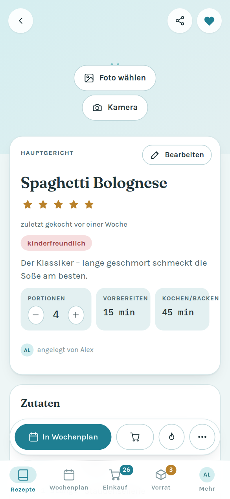<br><sub><b>Rezept</b> – Portionen umrechnen, Foto hinzufügen</sub></td>
    <td align="center" width="25%">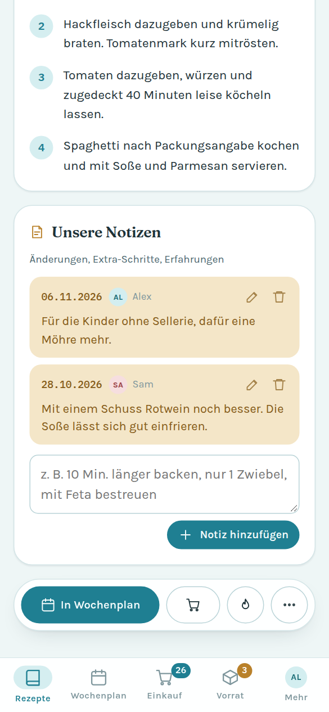<br><sub><b>Unsere Notizen</b> – datiert, mit Person</sub></td>
    <td align="center" width="25%">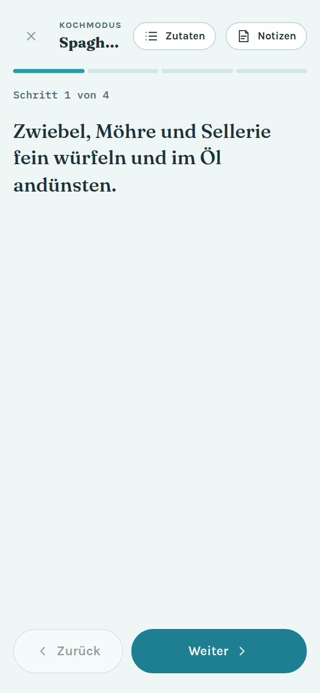<br><sub><b>Kochmodus</b> – ein Schritt pro Bildschirm</sub></td>
  </tr>
</table>

### Wochenplan, Einkauf und Vorrat

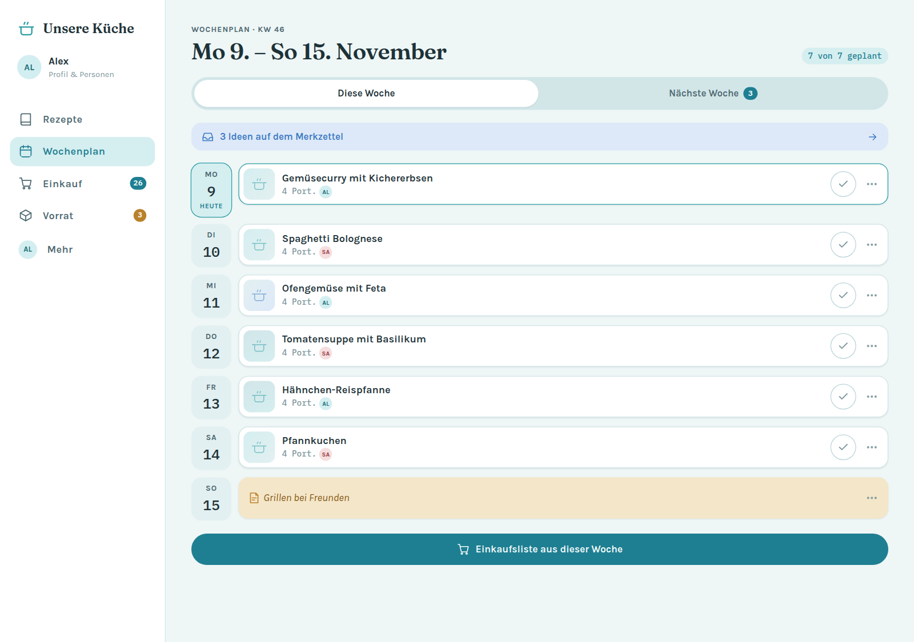

Der Wochenplan für den eingestellten Zeitraum. Ein Tipp auf
„Einkaufsliste aus dieser Woche“ erzeugt die Liste aus allen geplanten Rezepten.

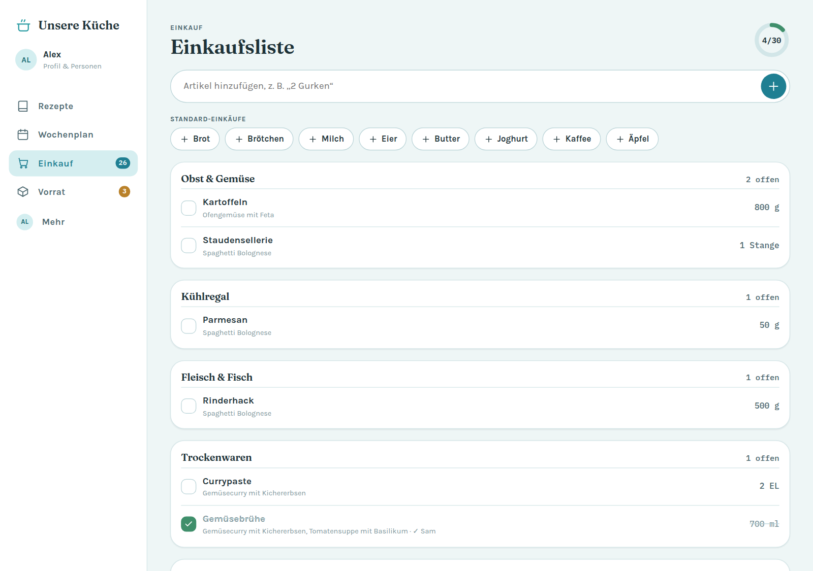

<table>
  <tr>
    <td align="center" width="33%">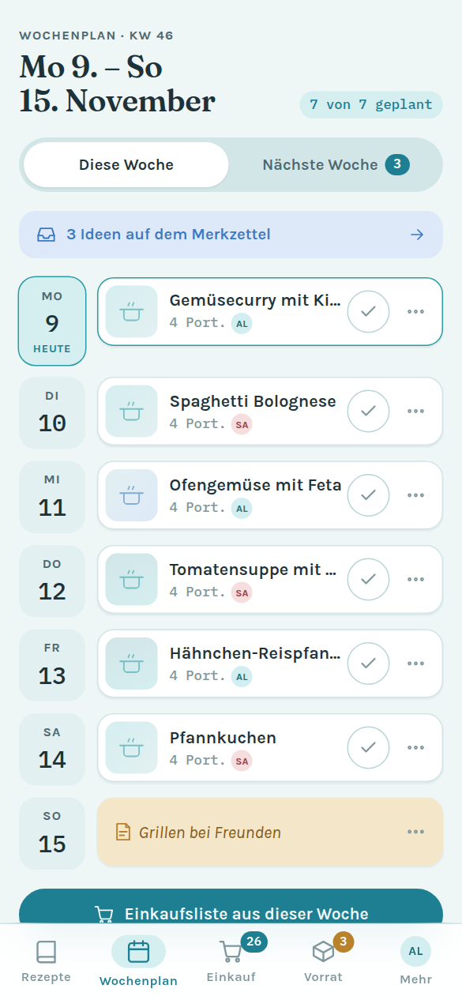<br><sub><b>Wochenplan</b> – Tage, Mahlzeiten, Merkzettel</sub></td>
    <td align="center" width="33%">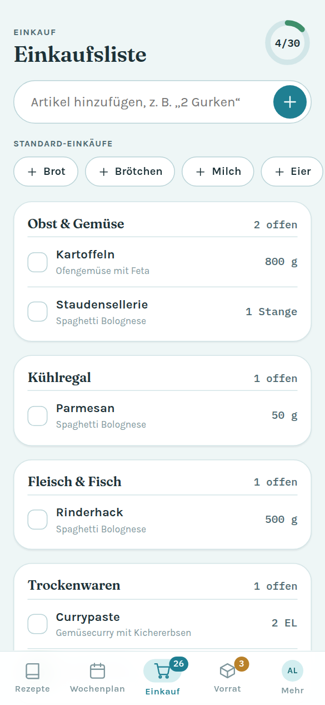<br><sub><b>Einkaufsliste</b> – nach Abteilungen, mit Herkunft</sub></td>
    <td align="center" width="33%">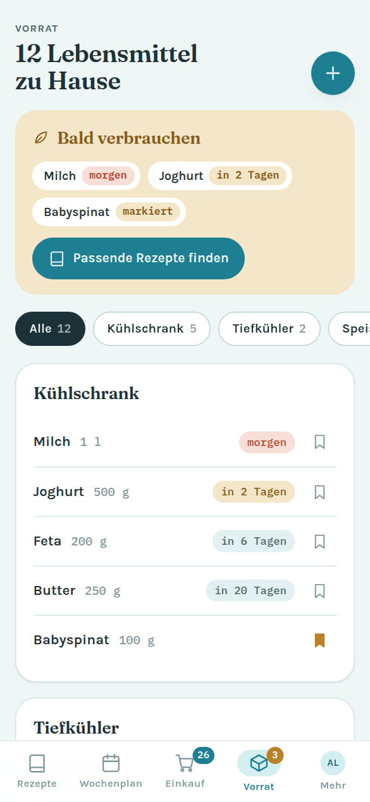<br><sub><b>Vorrat</b> – Haltbarkeit und „Bald verbrauchen“</sub></td>
  </tr>
</table>

### Importieren, Teilen und Einstellungen

<table>
  <tr>
    <td align="center" width="33%">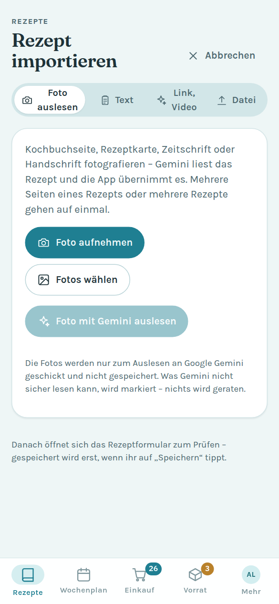<br><sub><b>Foto auslesen</b> – Gemini liest Kochbuchseiten</sub></td>
    <td align="center" width="33%">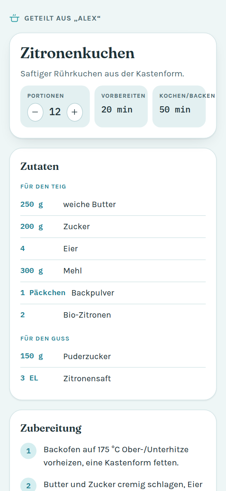<br><sub><b>Geteiltes Rezept</b> – ohne Anmeldung, als PDF speicherbar</sub></td>
    <td align="center" width="33%">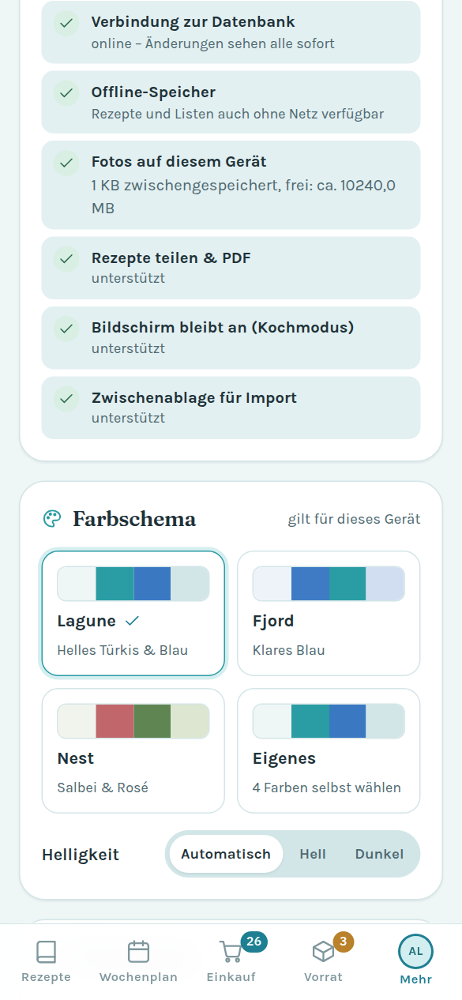<br><sub><b>Farbschema</b> – auch mit eigenen Farben</sub></td>
  </tr>
</table>

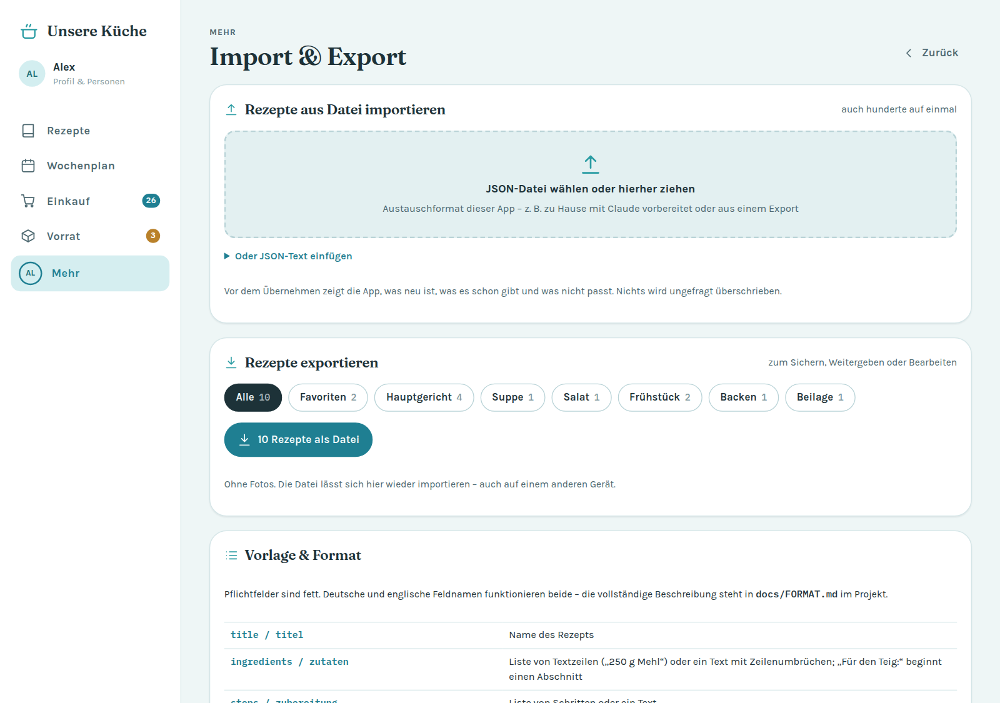

<table>
  <tr>
    <td align="center" width="50%">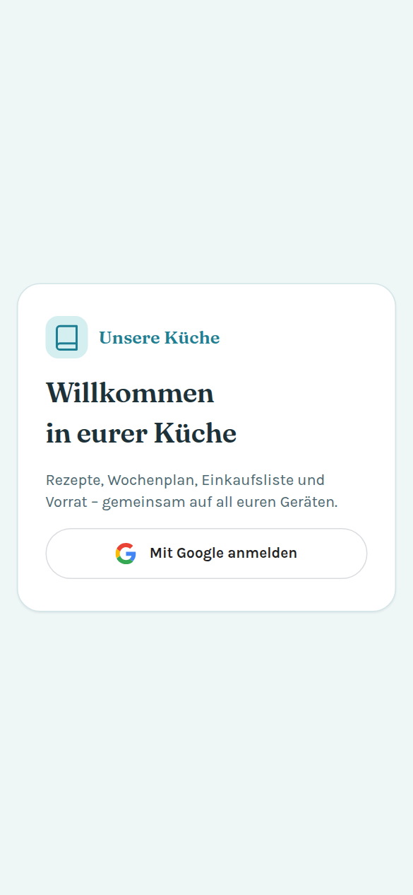<br><sub><b>Anmeldung</b> – nur freigegebene Google-Konten</sub></td>
    <td align="center" width="50%">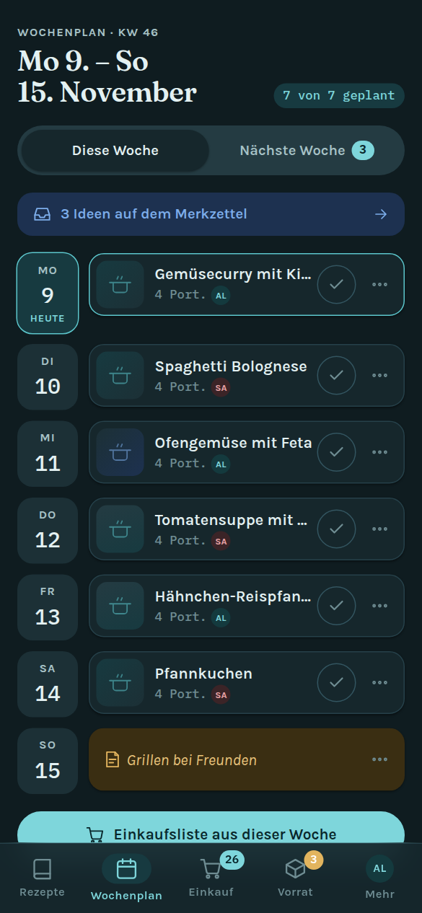<br><sub><b>Dunkles Design</b> – automatisch oder fest wählbar</sub></td>
  </tr>
</table>

---

## Technischer Stack

- **Frontend:** HTML, CSS und JavaScript-Module – ohne Build-Schritt, ohne Framework, ohne `npm install`
- **Datenbank:** [Cloud Firestore](https://firebase.google.com/docs/firestore) mit Offline-Speicher; Fotos als komprimierte Dokumente (kein Cloud Storage nötig)
- **Anmeldung:** [Firebase Authentication](https://firebase.google.com/docs/auth) mit Google-Konto
- **Rezepte aus Fotos:** [Firebase AI Logic](https://firebase.google.com/docs/ai-logic) mit der Gemini Developer API (optional)
- **Hosting:** [Firebase Hosting](https://firebase.google.com/docs/hosting); Service Worker für Offline-Start und Installation
- **Firebase JS SDK** 12.19.0 direkt von `gstatic.com`
- **Tests:** Node.js-Testrunner (`node --test`) und der Firestore-Emulator für die Zugriffsregeln
- **Kosten:** läuft im kostenlosen **Spark-Tarif** von Firebase – ohne Kreditkarte

---

## Projektstruktur

```
├── firebase.json                  Hosting, Firestore, Emulatoren
├── firestore.rules.example        Vorlage für die Zugriffsregeln (→ firestore.rules)
├── firestore.indexes.json
├── .firebaserc.example            Vorlage für die Projektzuordnung (→ .firebaserc)
├── package.json                   Skripte: start, emulators, test, test:rules, deploy
├── docs/
│   ├── FORMAT.md                  Austauschformat für Rezeptdateien
│   ├── rezepte-vorlage.json       Beispieldatei zum Importieren
│   └── screenshots/               Bilder für diese README (Beispieldaten)
├── public/                        wird veröffentlicht
│   ├── index.html                 App-Hülle
│   ├── teilen.html                öffentliche Seite für geteilte Rezepte
│   ├── sw.js                      Service Worker (Offline, Installation)
│   ├── manifest.webmanifest, icons/
│   ├── css/app.css
│   └── js/
│       ├── main.js                Start, Anmeldung, Navigation, Router
│       ├── firebase.js            Firebase-App, Google-Anmeldung, Firestore
│       ├── firebase-config.js     lädt die Zugangsdaten (Hosting oder lokale Datei)
│       ├── cloud.js               Abgleich mit Firestore, Fotos in Firestore
│       ├── store.js               Datenstand im Speicher (all/get/add/update/remove)
│       ├── model.js               reine Logik: Zutaten, Mengen, Einkaufsliste, Zeiträume
│       ├── ai-import.js           Rezeptfotos mit Gemini auslesen
│       ├── recipe-text.js         Rezepttext erkennen (Text-Import)
│       ├── exchange.js, importer.js   Austauschformat, Import/Export
│       ├── image.js, photos.js    Fotos verkleinern und speichern
│       ├── theme.js               Farbschemata
│       └── views/                 Rezepte, Rezept, Formular, Plan, Einkauf, Vorrat, Mehr …
└── tests/                         Unit-Tests und Regeltests
```

---

## Voraussetzungen

- Ein Google-Konto für die [Firebase-Konsole](https://console.firebase.google.com)
- [Node.js](https://nodejs.org) 20 oder neuer (nur für Tests und die Firebase-Kommandozeile)
- [Firebase CLI](https://firebase.google.com/docs/cli): `npm install -g firebase-tools`, danach `firebase login`
- Java 11+ für die lokalen Firebase-Emulatoren (optional)
- Python 3 für den lokalen Webserver (`npm start`) – oder jeder andere statische Server

---

## Setup Schritt 1: Firebase-Projekt einrichten

1. In der [Firebase-Konsole](https://console.firebase.google.com) ein neues Projekt anlegen
   (Google Analytics wird nicht gebraucht).
2. **Web-App registrieren:** Projektübersicht → „App hinzufügen“ → Web (`</>`).
   Die angezeigte Konfiguration brauchst du nur für die lokale Entwicklung (Schritt 3).
3. **Firestore anlegen:** *Datenbanken und Speicher → Firestore Database → Datenbank erstellen*,
   Standort z. B. `eur3` (Europa), im **Produktionsmodus** starten.
4. **Google-Anmeldung einschalten:** *Sicherheit → Authentication → Jetzt starten →
   Sign-in method → Google → Aktivieren*, Support-E-Mail wählen, speichern.
5. **Optional – Rezepte aus Fotos:** *KI-Dienste → AI Logic → Jetzt starten →*
   **Gemini Developer API** wählen (nicht Vertex AI – die braucht den kostenpflichtigen Tarif).
   Ohne diesen Schritt funktioniert alles außer „Foto auslesen“.

Oder per Kommandozeile (Schritte 1–3):

```bash
firebase projects:create mein-kuechen-projekt --display-name "Unsere Kueche"
firebase apps:create web "Unsere Kueche Web" --project mein-kuechen-projekt
firebase firestore:databases:create "(default)" --location eur3 --project mein-kuechen-projekt
```

Die Google-Anmeldung (Schritt 4) und AI Logic (Schritt 5) lassen sich nur in der Konsole einschalten.

---

## Setup Schritt 2: Zugriffsregeln anlegen

Wer die App benutzen darf, steht **ausschließlich** in den Firestore-Regeln –
die App selbst enthält keine Adressen.

```bash
cp firestore.rules.example firestore.rules
```

In `firestore.rules` die Google-Adressen eintragen:

```
request.auth.token.email in [
  "person1@example.com",
  "person2@example.com"
];
```

Alle Daten liegen unter `households/kueche/…`. Nur angemeldete Konten mit
**bestätigter** Adresse aus dieser Liste dürfen lesen und schreiben; alles
andere ist gesperrt. `firestore.rules` ist in `.gitignore` eingetragen, damit
die echten Adressen nicht im Repository landen.

Neue Person freischalten: Adresse ergänzen und `firebase deploy --only firestore:rules`.

---

## Setup Schritt 3: Lokale Entwicklung

**Mit den Firebase-Emulatoren** (empfohlen, keine echten Daten):

```bash
npm run emulators          # Auth- und Firestore-Emulator
npm start                  # zweites Terminal: Webserver auf Port 5180
```

Dann <http://localhost:5180/?emu=1> öffnen. Im Emulator-Modus gibt es eine
**Test-Anmeldung** mit einer beliebigen Adresse aus deiner `firestore.rules`;
die App spricht dann nur mit dem Emulator-Projekt `demo-…`.
`?emu=0` schaltet zurück.

**Gegen das echte Projekt** (z. B. um „Foto auslesen“ zu testen):

```bash
cp public/js/firebase-config.local.example.js public/js/firebase-config.local.js
```

und die Werte aus der Firebase-Konsole eintragen (*Projekteinstellungen → Meine Apps → Web-App*).
Die Datei ist in `.gitignore` eingetragen und wird nicht veröffentlicht – auf
Firebase Hosting holt sich die App die Werte automatisch aus `/__/firebase/init.json`.

> Beim ersten Start mit leerer Datenbank legt die App eine Grundeinrichtung an:
> Kategorien, Tags, Supermarkt-Abteilungen, einen Zutaten-Katalog und
> Standard-Einkäufe. Rezepte, Pläne und Listen starten leer.

---

## Setup Schritt 4: Deployment auf Firebase Hosting

```bash
cp .firebaserc.example .firebaserc     # Projekt-ID eintragen
npm test                               # Unit-Tests
npm run test:rules                     # Zugriffsregeln im Emulator prüfen
npm run deploy                         # Hosting + Firestore-Regeln
```

Danach läuft die App unter `https://<projekt-id>.web.app`.

**Updates:** Bei jeder Änderung `CACHE` in `public/sw.js` hochzählen und neue
Dateien in `APP_SHELL` eintragen – ein Test prüft, dass keine fehlt. Geöffnete
Apps holen sich die neue Version beim nächsten Laden.

**Auf dem Handy installieren:** Android und Desktop über „Als App installieren“
unter *Mehr → App & Gerät*; iPhone/iPad über *Teilen → Zum Home-Bildschirm*
(die App zeigt dafür eine Schritt-für-Schritt-Anleitung).

---

## Rezepte importieren

| Weg | Wofür | Wie |
|---|---|---|
| 📸 **Foto auslesen** | Kochbuchseiten, Rezeptkarten, Zeitschriften, Handschrift | Foto aufnehmen oder mehrere wählen → „mit Gemini auslesen“ → bei einem Rezept öffnet sich das Formular zum Prüfen, bei mehreren die Importvorschau |
| 📋 **Text** | Rezept von Webseiten, Instagram, WhatsApp | Text einfügen – Titel, Zutaten und Schritte werden erkannt |
| ✨ **Link, Video** | Instagram-Reels, YouTube, Webseiten | Anweisung kopieren, Gemini oder ChatGPT öffnen, Antwort zurück einfügen (kostenlos, ohne Einrichtung) |
| 📄 **Datei** | viele Rezepte auf einmal | JSON im [Austauschformat](docs/FORMAT.md) – z. B. vorher mit einer KI aus Fotos oder PDFs erstellt; Vorlage: [docs/rezepte-vorlage.json](docs/rezepte-vorlage.json) |

**So arbeitet „Foto auslesen“:** Die Fotos werden auf ca. 2000 px verkleinert
und über Firebase AI Logic an Gemini geschickt, zusammen mit festen Regeln:
Mengen und Schritte genau übernehmen, Fortsetzungsseiten zusammenfassen,
angeschnittene Rezepte weglassen, nicht Lesbares in `uncertain` beschreiben
statt zu raten, fremdsprachige Rezepte ins Deutsche übersetzen. Gemini
antwortet als JSON nach festem Schema; die App zeigt Unsicheres gelb im
Formular und speichert es als Notiz. Die Fotos selbst werden nicht
gespeichert. Im kostenlosen Tarif gilt ein Tageslimit von Google; dort dürfen
eingesendete Inhalte zur Verbesserung der Dienste verwendet werden.

---

## Konfiguration

| Was | Wo |
|---|---|
| Firebase-Zugangsdaten | automatisch über Hosting; lokal `public/js/firebase-config.local.js` |
| Wer Zugriff hat | `firestore.rules` (E-Mail-Liste) |
| Haushalts-Dokument | `HOUSEHOLD_ID` in `public/js/firebase.js` (Standard `kueche`) |
| Gemini-Modell | `MODELS` in `public/js/ai-import.js` (neuestes Flash-Modell, dann Rückfall) |
| Planungszeitraum, Mahlzeiten, Kategorien, Tags, Abteilungen, Standard-Einkäufe | in der App unter *Mehr* (gilt für alle) |
| Farbschema und Helligkeit | in der App unter *Mehr* (gilt pro Gerät) |
| Grundeinrichtung für neue Haushalte | `public/js/seed.js` |
| Foto-Komprimierung | `public/js/image.js` (längste Seite 1280 px, Ziel ca. 50–190 KB) |

---

## Tests

```bash
npm test             # Kernlogik: Zutaten zerlegen, Mengen, Einkaufsliste, Zeiträume,
                     # Text- und Foto-Import, Austauschformat, Fotos, App-Hülle
npm run test:rules   # Zugriffsregeln gegen den Firestore-Emulator
```

Die Regeltests lesen die freigeschalteten Adressen aus `firestore.rules`
(ohne eigene Datei aus der Vorlage) und prüfen: Freigeschaltete dürfen lesen
und schreiben; fremde Konten, unbestätigte Adressen und Gäste nicht; alles
außerhalb des Haushalts ist gesperrt.

---

## Datenbank-Schema

```
households/kueche                     { settings: {...}, version }
households/kueche/recipes/{id}        title, description, servings, prepMin, cookMin,
                                      ingredients[{amount, unit, name, note, section}],
                                      steps[], categoryIds[], tagIds[], noteLog[],
                                      rating, favorite, lastCookedAt, photoId, by, createdAt
households/kueche/mealPlan/{id}       date, slot, recipeId | note, servings, cooked, by
households/kueche/planInbox/{id}      recipeId | note, servings   (Merkzettel)
households/kueche/shoppingItems/{id}  key, name, amountText, aisle, source, checked, checkedBy
households/kueche/pantry/{id}         name, amount, location, expiresAt, useSoon
households/kueche/categories|tags|staples|catalog/{id}
households/kueche/photos/{id}         full, thumb (Bytes), Typ, Größe
```

`settings` enthält Haushaltsname, Personen (Anzeigename, Farbe, verknüpftes
Google-Konto), Mahlzeiten, Planungszeitraum und die Reihenfolge der
Abteilungen. Die App hält den Stand im Speicher und schreibt nach jeder
Änderung nur die geänderten Dokumente.

---

## Troubleshooting

| Problem | Lösung |
|---|---|
| „Kein Zugriff“ nach der Anmeldung | Adresse fehlt in `firestore.rules` oder Regeln nicht veröffentlicht (`firebase deploy --only firestore:rules`) |
| Google meldet „Zugriff blockiert“ | Im [Google Cloud-Projekt](https://console.cloud.google.com/auth/audience) unter *Testnutzer* die Adressen eintragen |
| „Firebase-Konfiguration fehlt“ | Lokal fehlt `public/js/firebase-config.local.js` – oder die App läuft nicht über Firebase Hosting |
| „Gemini ist noch nicht eingeschaltet“ | AI Logic in der Konsole aktivieren (Setup Schritt 1.5); danach ein paar Minuten warten |
| „Kontingent aufgebraucht“ | Tageslimit des kostenlosen Tarifs erreicht – später erneut oder den Weg „Link, Video“ nutzen |
| Nach einem Update alte Version | Seite einmal neu laden; der Service Worker holt die neue Version |
| Pop-up für die Anmeldung blockiert | Pop-ups für die Seite erlauben |

---

## Sicherheitshinweise

- Die Firebase-Konfiguration (API-Key usw.) ist **nicht geheim** – sie steht in
  jeder Web-App. Geschützt werden die Daten durch die Anmeldung und die
  serverseitigen Firestore-Regeln.
- Echte E-Mail-Adressen stehen nur in `firestore.rules`, die nicht ins
  Repository gehört (siehe `.gitignore`).
- Für „Foto auslesen“ empfiehlt sich [App Check](https://firebase.google.com/docs/app-check),
  damit nur eure App das Gemini-Kontingent nutzt.
- Geteilte Rezept-Links enthalten das Rezept selbst (komprimiert im Link) und
  lassen sich nicht zurückziehen.
- Beim Abmelden löscht die App den Offline-Speicher des Geräts.

---

## Lizenz

Privates Projekt. Lizenz nach Bedarf ergänzen (z. B. MIT), falls das Projekt
weiterverwendet werden soll.
